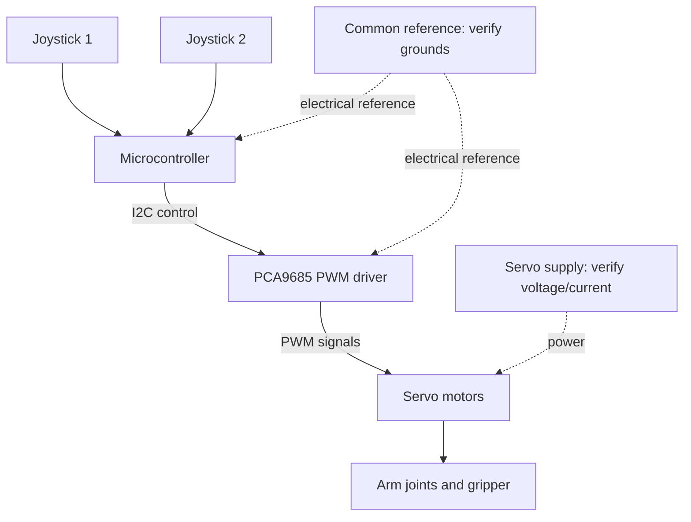

# Electronics and control architecture

## High-level components

- **Two analog joysticks:** User movement commands
- **Microcontroller:** Reads joystick values and computes output commands
- **PCA9685 PWM driver:** Generates servo command pulses
- **Servos:** Move joints and the gear-driven gripper
- **External power:** Supplies the servo load (rating and exact arrangement to verify)

This is a **functional diagram**, not a verified wiring schematic.

## What must be verified from hardware and firmware

| Item | Current documentation status |
| --- | --- |
| Exact MCU board | Not yet provided |
| Joystick analog pins | Not yet provided |
| Joystick pushbutton wiring | Unknown / may be unused |
| PCA9685 SDA/SCL connections | Not yet provided |
| PCA9685 I²C address | Not yet provided |
| Servo output channels | Not yet provided |
| Servo model and voltage | Not yet provided |
| Servo power voltage and amperage | Not yet provided |
| Ground topology | Needs physical verification |

## Electrical integration considerations

- Verify the microcontroller logic supply and the servo power supply independently.
- Power servos from a correctly rated source, rather than assuming the microcontroller's 5 V pin can handle the load.
- Check that the controller and driver share the reference required for reliable control signals, subject to the actual board wiring.
- Confirm stall/peak current requirements before changing the servo power source.
- Route wires away from rotating joints and pinching points.

## Documentation to add

1. Photos showing the actual electronics inside the controller box.
2. Labeled pin/channel map from the working `.ino` sketch.
3. A true schematic reflecting as-built connections.
4. Voltage/current ratings and fuse/protection details if applicable.

[Components list](../Electronics/COMPONENTS.md) · [Back to README](../README.md)
