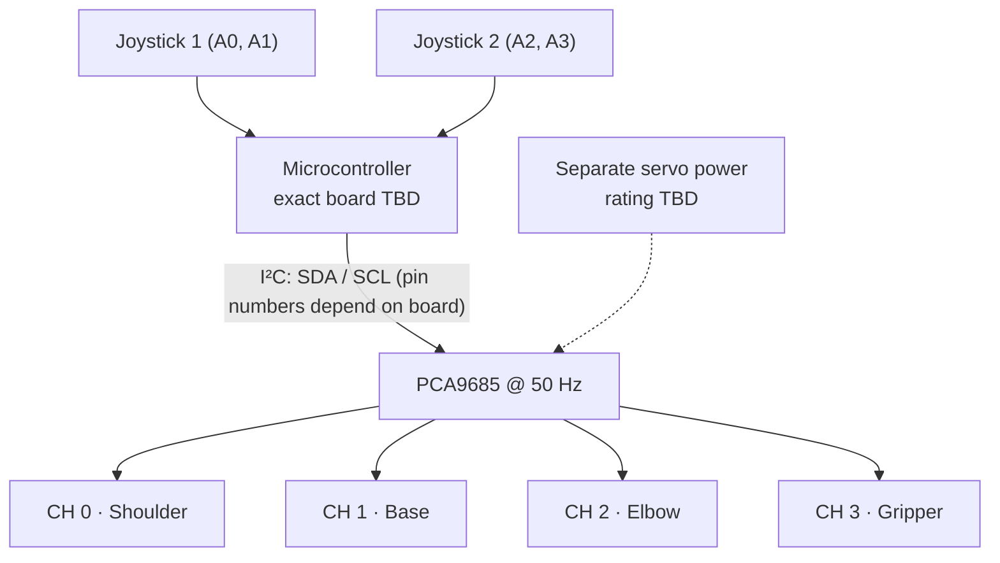

# Electronics Architecture and Wiring Verification

## System overview

Four analog channels from two joystick modules are read by an Arduino-compatible microcontroller. I²C control is sent to a PCA9685 PWM board, which generates command pulses on channels 0–3 for four servos (three arm axes and the gripper).

**Warning:** This is a firmware-derived *functional* diagram, **not** a verified electrical schematic or permission to wire untested hardware.

## Pin map confirmed by the code

| MCU analog input | Code name | Actuator |
| --- | --- | --- |
| A0 | `joy1X` | Shoulder |
| A1 | `joy1Y` | Base |
| A2 | `joy2X` | Gripper |
| A3 | `joy2Y` | Elbow |

PCA9685 servo channels: **0 shoulder, 1 base, 2 elbow, 3 gripper**. The source uses `Adafruit_PWMServoDriver pwm = Adafruit_PWMServoDriver();`, with no explicit alternate I²C address. Board-specific SDA/SCL pins are not stated in the source.

## Details requiring physical inspection

- The precise MCU model and I²C pin numbering.
- VCC (logic) and V+ (servo supply) operating voltages.
- Power supply current rating, distribution and shared ground reference.
- Servo model, peak/stall-current ratings, connectors and wiring directions.
- Whether protection (fuse, switch, etc.) exists.
- Correct PCA9685 terminal labeling and cable strain relief.

**Servo power note:** A hobby-servo supply must support expected peak current. Never assume a microcontroller's logic pin or USB connection is suitable for powering all servos.

See [component list](../Electronics/COMPONENTS.md) and [engineering checklist](Robotic_Arm_Engineering_Information_Checklist.xlsx).