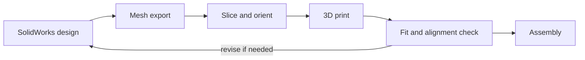

# Manufacturing and assembly

## Process

The custom-designed mechanical components were fabricated with a **Bambu Lab P1S** using FDM printing.

## Print preparation

Review each part for:

- Bed contact and orientation relative to mechanical loads.
- Overhangs, support needs, and support-removal access.
- Hole dimensions and clearance for hardware.
- Infill/wall requirements based on the part's function.
- Orientation of layers at stressed bracket features.
- Print quality around mating or sliding surfaces.

**Print profile data (temperature, nozzle size, layer height, walls, infill, supports and filament) has not yet been supplied.** Those numbers should be copied from the actual slicer project or project notes.

## Assembly sequence (high level)

1. Inspect printed parts for defects, holes, and fit.
2. Attach the base and shoulder components.
3. Install servo motors and confirm output shaft alignment.
4. Assemble the arm and forearm links using the correct spacers/fasteners.
5. Assemble gripper gears and fingers; check free motion without a load.
6. Place joysticks/electronics in the custom control enclosure.
7. Route wires clear of moving joints; verify electrical connections.
8. Test servo motion at low demand before full operation.

The exact screw order, fastener sizes, and joint reference positions require the final CAD and prototype photos to confirm.

## Design-for-manufacture observations

The project included evaluation of arm plates, shoulder U-bracket, spacers, gripper gear and electronic enclosure printing, including orientation/support choices and component reprints. Document each major revision with a before/after image and reason.

## Items to add

- Printer/slicer profile screenshots (per part when settings differ).
- Filament type and brand, optional print times and material usage.
- Fastener sizes and physical assembly drawing.
- Photos from assembly and fit checks.

[Mechanical design](MECHANICAL_DESIGN.md) · [Back to README](../README.md)
