# Final Assembled Prototype

The photos show the assembled robotic arm, its mechanical interfaces, and the electronics in the printed control box. Select a caption to open the full image.

## Full Arm

| [Full prototype and controller](main-view.webp) | [Side view and controller](side-view.webp) | [Front view](front-view.webp) |
| :---: | :---: | :---: |
| 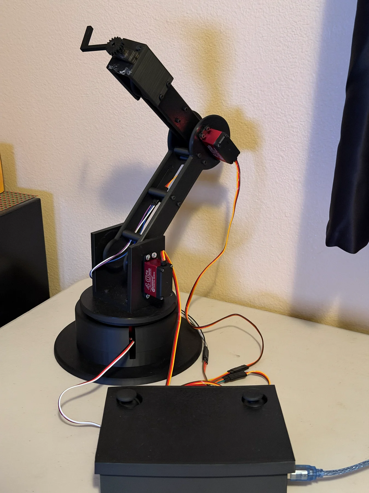 | 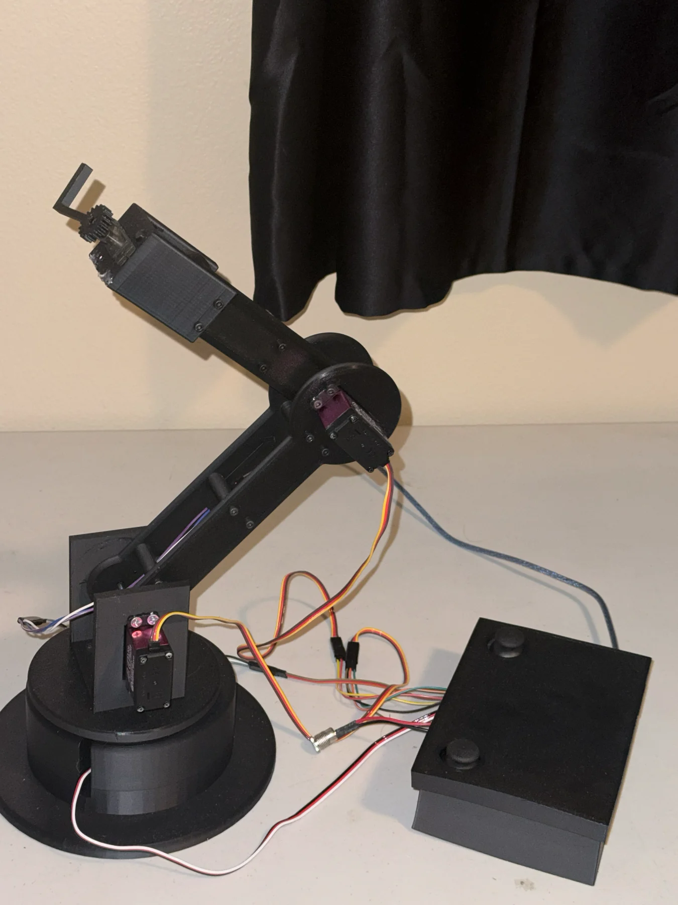 | 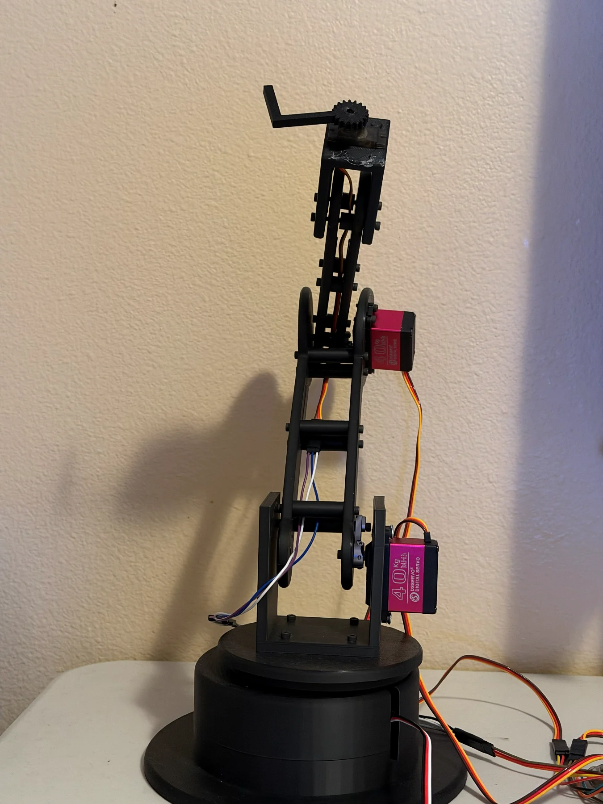 |
| [Rear oblique view](rear-oblique-view.webp) | [Side profile](side-profile-view.webp) | [Upper oblique view](upper-side-view.webp) |
| 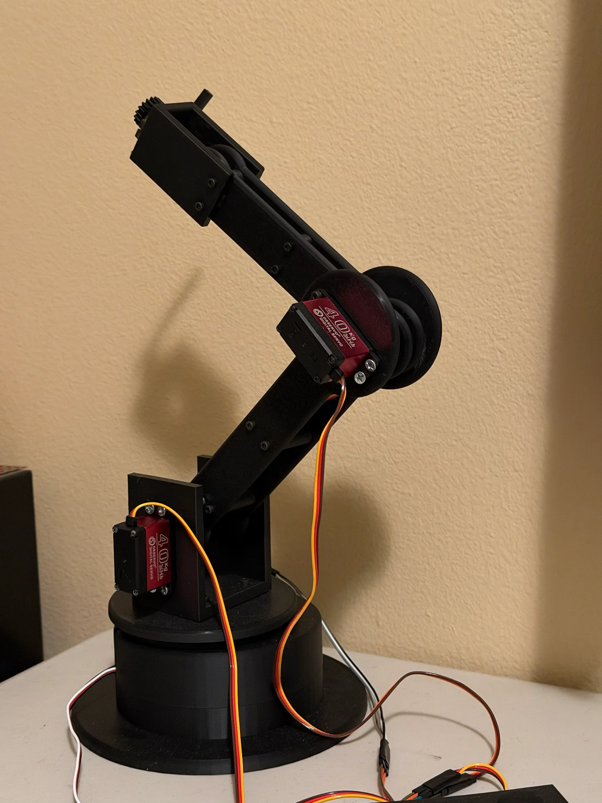 | 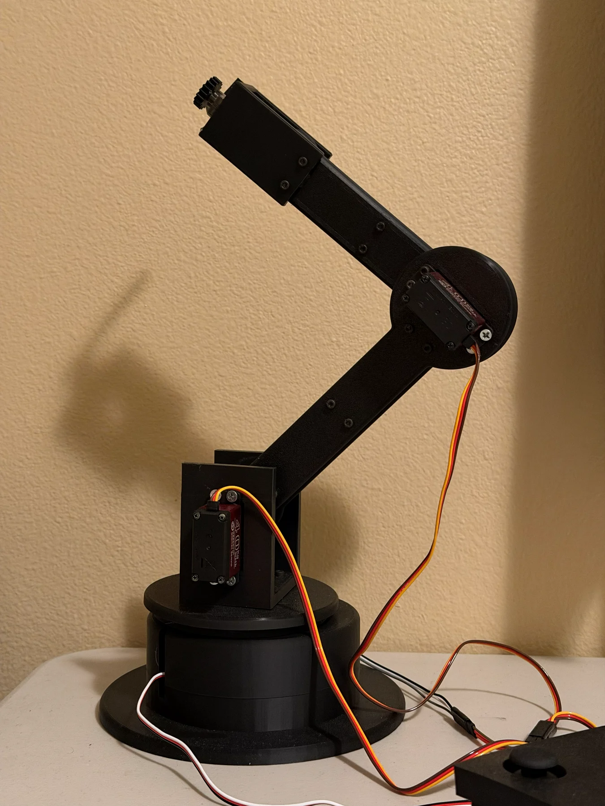 | 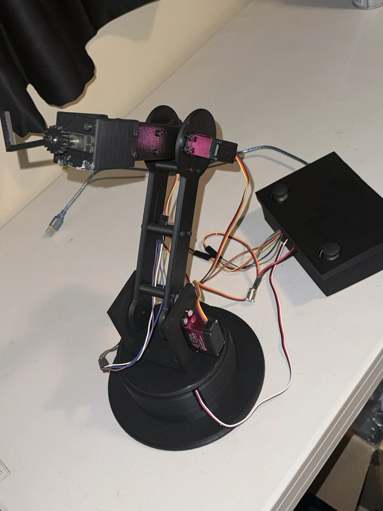 |

## Mechanical Details

| [Geared gripper](gripper-detail.webp) | [Base assembly](base-assembly.webp) | [Base adapter](base-adapter.webp) |
| :---: | :---: | :---: |
| 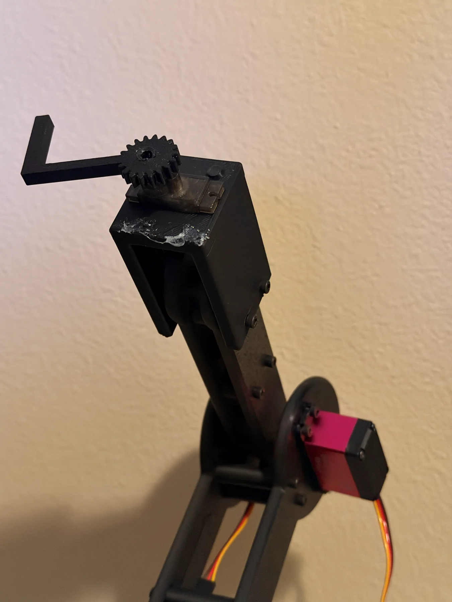 | 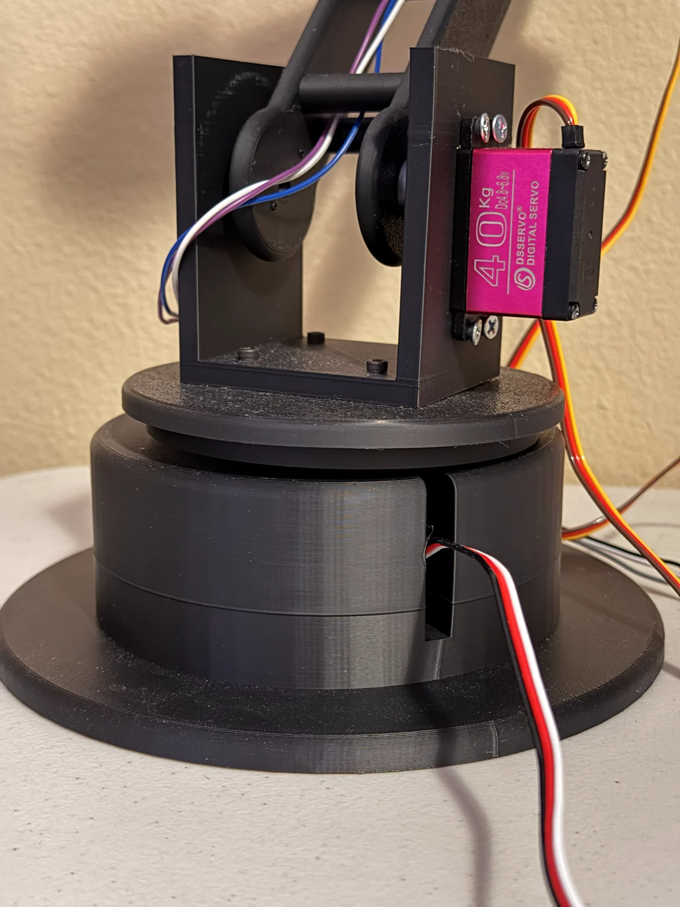 | 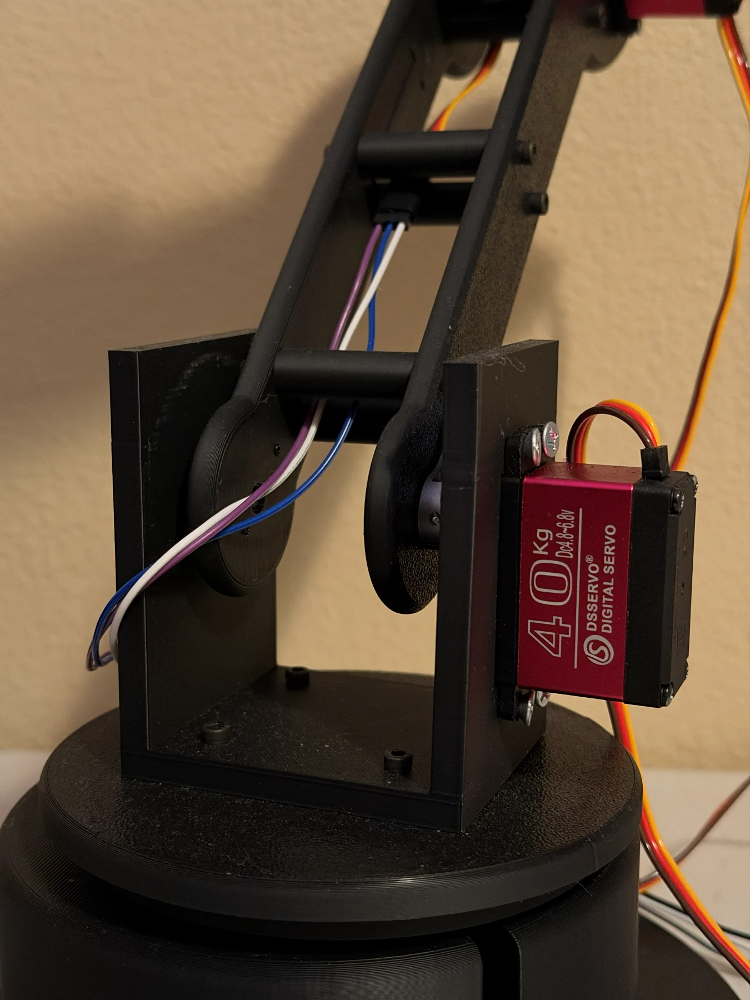 |

## Control Box

| [Closed enclosure](controller-view.webp) | [Open enclosure](controller-open.webp) |
| :---: | :---: |
| 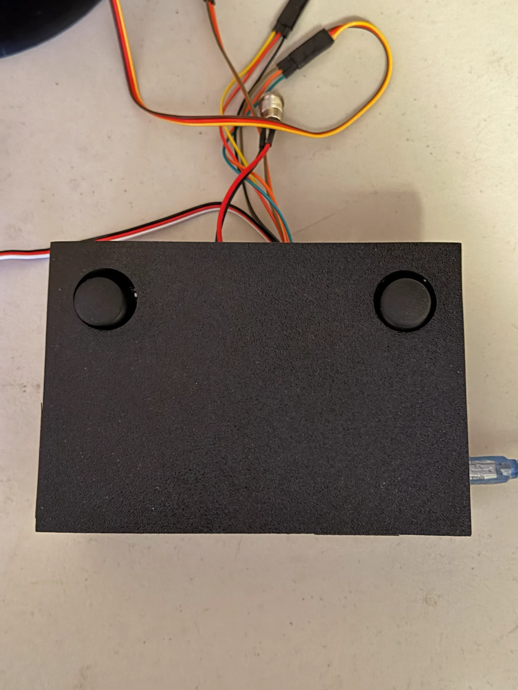 | 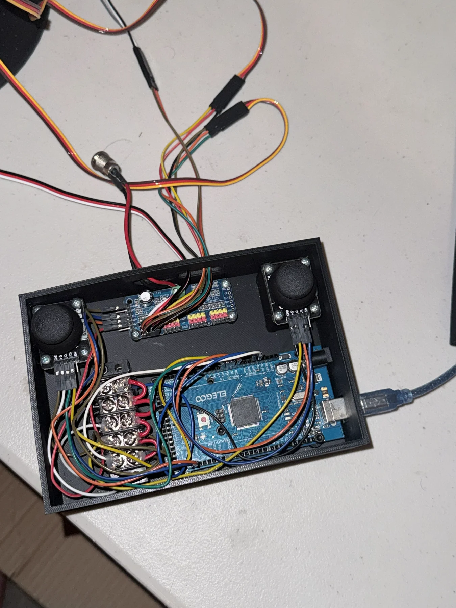 |
| [Arduino board and servo driver](controller-inner-detail-1.webp) | [Terminal block and internal wiring](controller-inner-detail-2.webp) |
| 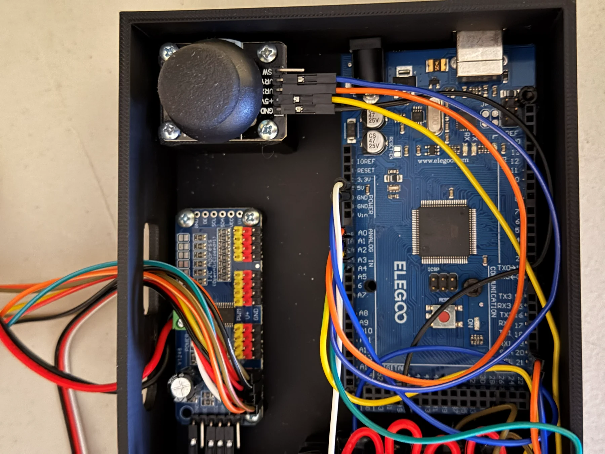 | 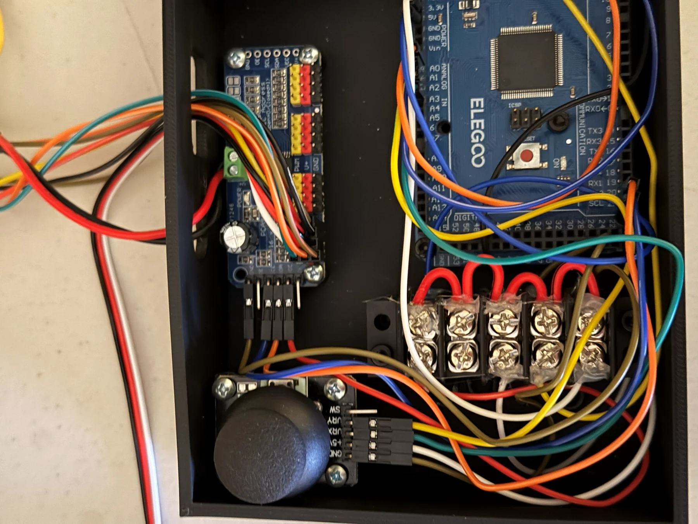 |

[Back to the project README](../../README.md)
