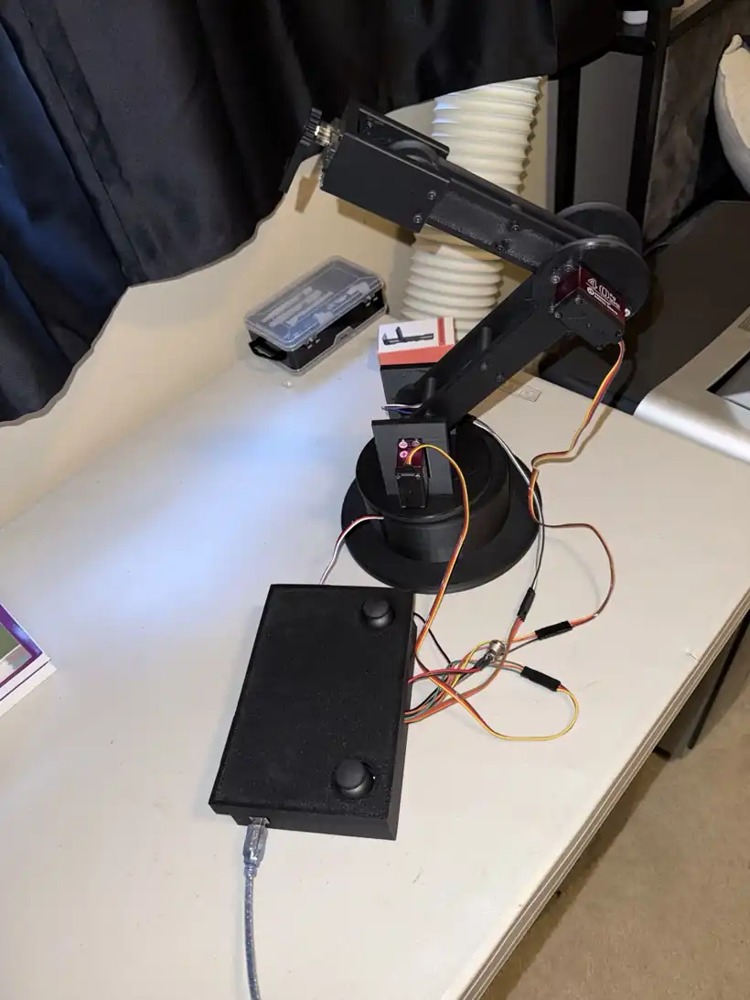
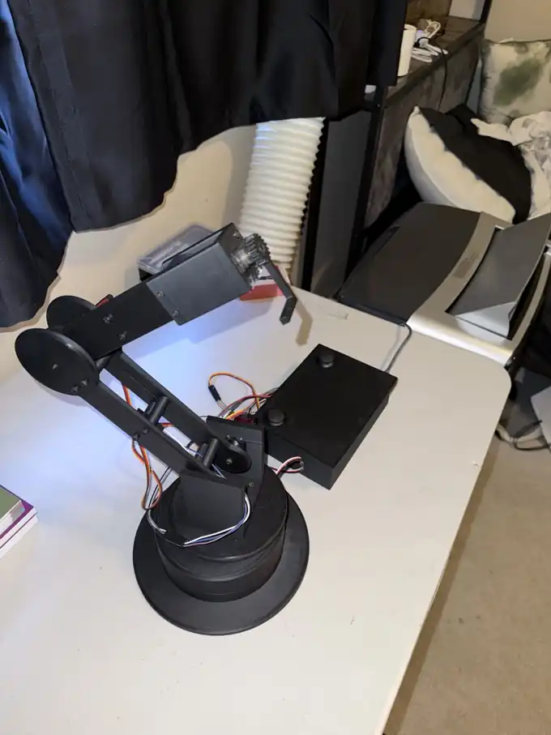
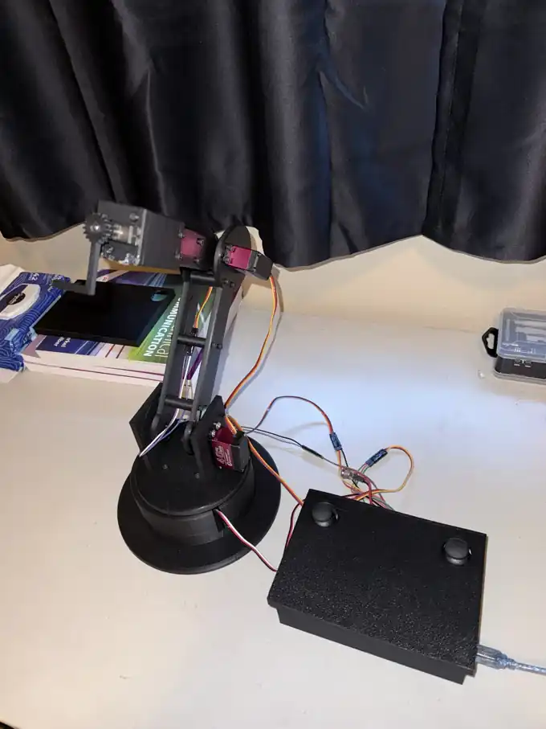
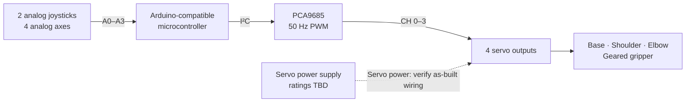

<div align="center">

# 3D-Printed Robotic Arm

### From CAD Design to a Functional Mechatronics Prototype

**SolidWorks** &nbsp;•&nbsp; **FDM 3D Printing** &nbsp;•&nbsp; **Arduino / C++** &nbsp;•&nbsp; **Servo Control**

A custom-designed, joystick-controlled robotic arm integrating 3D-printed mechanical structures, servo-driven joints, a gear-driven gripper, and embedded electronics.



*Assembled prototype — articulated arm, custom base, gripper and separate joystick controller.*

</div>

<table>
<tr>
<td align="center" width="50%"><br /><sub><b>Side view</b> — linkage arrangement and servo mounting</sub></td>
<td align="center" width="50%"><br /><sub><b>Controller view</b> — enclosed dual-joystick interface and cabling</sub></td>
</tr>
</table>

> **Status:** Physical prototype assembled; joystick-controlled motion has been exercised during development. CAD source exports, physical measurements and formal performance test results are being documented. The original Arduino sketch and three real prototype photos are included in this repository.

## Contents

- [Project Highlights](#project-highlights)
- [System Architecture](#system-architecture)
- [Technical Specifications](#technical-specifications)
- [Mechanical Design](#mechanical-design)
- [Electronics and Firmware](#electronics-and-firmware)
- [Engineering Challenges and Design Iterations](#engineering-challenges-and-design-iterations)
- [Manufacturing and Testing](#manufacturing-and-testing)
- [Repository Structure](#repository-structure)
- [Getting Started and Safety](#getting-started-and-safety)
- [Next Steps](#next-steps)

## Project Highlights

This project was developed as a **design–build–test mechatronics exercise** rather than an assembly of a pre-existing robotic-arm kit. The mechanical components were modeled in **SolidWorks**, fabricated using a **Bambu Lab P1S**, assembled with servo actuators and manually controlled through two analog joysticks.

| Engineering area | Implemented work |
| --- | --- |
| **Mechanical design** | Custom base, shoulder supports, articulated links, servo mounts, spacers and geared gripper |
| **Manufacturing** | FDM-printed components with consideration of part orientation, support material, fasteners and fit |
| **Electronics** | Arduino-based controller, PCA9685 PWM servo driver and analog joystick inputs |
| **Firmware** | C++ sketch with servo-channel assignments, joystick-to-position mapping, deadzones, command increments and software limits |
| **Engineering iteration** | Investigation of actuator alignment, joystick direction mapping, startup behavior and print-fit issues |

**Read the source:** [Arduino sketch](Firmware/Robotic_Arm_Porject_2.ino) · [Firmware walkthrough](Documentation/FIRMWARE_AND_CONTROLS.md) · [Source-code review](Documentation/CODE_REVIEW.md)

## System Architecture



*Functional architecture derived from the source code and project description. This is not a verified pin-level power/wiring schematic.*

The firmware commands **three arm joints plus the gripper**: base rotation, shoulder, elbow and gripper. Servo output position is updated while the joystick is displaced from its center region. No inverse kinematics or autonomous path planning is claimed.

## Technical Specifications

### Confirmed from the uploaded firmware

| Actuator | PCA9685 channel | Nominal servo type in code | Startup command | Software angle limits | Joystick input | Deadzone | Max angle step per loop |
| --- | ---: | --- | ---: | --- | --- | ---: | ---: |
| **Base** | 1 | 270° | 135° | 10–260° | A1 (`joy1Y`) | 70 | 3° |
| **Shoulder** | 0 | 180° | 90° | 20–160° | A0 (`joy1X`) | 70 | 2° |
| **Elbow** | 2 | 180° | 90° | 20–160° | A3 (`joy2Y`) | 70 | 3° |
| **Gripper** | 3 | 180° | 90° | 30–120° | A2 (`joy2X`) | 50 | 5° |

Other code constants: **PCA9685 at 50 Hz**, joystick center **512**, servo pulse endpoints **100–650 driver counts**, serial output **9600 baud**, and nominal loop delay **10 ms**. The last column is a software *increment per loop*, **not a measured angular velocity**. Servo type labels and software limits are from the sketch, not independently measured hardware capabilities.

**Exact servo models, microcontroller board, power-supply rating, physical reach, payload, material type and true range of motion are not yet confirmed.** A structured [engineering information spreadsheet](Documentation/Robotic_Arm_Engineering_Information_Checklist.xlsx) identifies the missing data without inventing values.

## Mechanical Design

The printed design consists of a rotational base and shoulder support, connected arm/forearm linkages, servo mounting interfaces and a **gear-driven two-finger end effector**. The separate controller includes a printed case/lid and two joystick modules.

| Subassembly | Engineering considerations |
| --- | --- |
| **Base & shoulder** | Stability, rotation clearance, actuator mounting and fastener access |
| **Arm & forearm** | Link geometry, stiffness, assembly spacing and print orientation |
| **Servo mounts** | Output shaft alignment, mechanical clearance and secure fastening |
| **Gripper** | Gear engagement, finger positioning and travel interference |
| **Controller enclosure** | Joystick access, electronic mounting, lid fit and serviceability |

The design required moving between CAD modeling, printed prototypes and physical fit checks. See [Mechanical Design](Documentation/MECHANICAL_DESIGN.md) and [Manufacturing & Assembly](Documentation/MANUFACTURING_AND_ASSEMBLY.md).

> **CAD publication:** Native SolidWorks assemblies/parts and STL exports will be added to [CAD/](CAD/) when provided. No simulated render is being presented as an actual CAD deliverable.

## Electronics and Firmware

The uploaded [original Arduino sketch](Firmware/Robotic_Arm_Porject_2.ino) uses `Wire.h` and the `Adafruit_PWMServoDriver` library. The controller samples four analog channels (`A0`–`A3`), computes incremental servo commands using **per-axis deadzones and sensitivity settings**, clamps target angles and writes them to the PCA9685.

The code labels joystick 1 as the right stick and joystick 2 as the left stick, but the **physical orientation and movement direction still require a live verification**. The wiring is not established simply by reading the sketch.

Key control functions include `joystickToSpeed()`, `moveServo180()`, `moveServo270()`, `slowMove180()` and `slowMove270()`.

**Important technical finding:** `setup()` calls `slowMove...()` with equal start and end angles for each axis. As currently written, those calls send only one commanded starting position per servo; they do **not** guarantee gradual travel from the servo's actual power-on position. Similarly, the configured 100–650 PCA9685-count span at 50 Hz corresponds approximately to **488–3174 μs**; its suitability must be checked against the actual servo models before calibration changes or further testing.

Detailed references: [Electronics & wiring](Documentation/ELECTRONICS_AND_CONTROL.md) · [Firmware behavior](Documentation/FIRMWARE_AND_CONTROLS.md) · [Code review](Documentation/CODE_REVIEW.md) · [Component list](Electronics/COMPONENTS.md).

## Engineering Challenges and Design Iterations

| Challenge observed | Engineering response / next validation |
| --- | --- |
| Joystick axes initially controlled unintended movements | Remap joystick channels and test physical movement directions on the assembled prototype |
| Rapid movement on power-up affected stability | Inspect commanded initial positions; implement and validate a true staged ramp if necessary |
| Servo alignment and bracket fit | Compare shaft position and mating geometry against CAD and as-built dimensions |
| Printed-part orientation and fit | Adjust print setup or part geometry, then assess assembly after fabrication |
| Wiring near moving joints | Verify clearance and strain relief through the complete physical motion range |

Detailed [design iteration notes](Documentation/DESIGN_ITERATIONS.md) distinguish observations from changes that still need proof through test results or photos.

## Manufacturing and Testing

**Production equipment:** Bambu Lab P1S FDM 3D printer. Parts were printed, fitted, assembled and adjusted iteratively. The source slicer settings have not been provided, so layer height, wall count, infill and filament are **not** asserted.

Proposed tests are listed in [Testing & Validation](Documentation/TESTING_AND_VALIDATION.md), with a [CSV test log](Documentation/test-log.csv) for objective observations. A credible quantitative result (joint travel, gripper opening, repeatability or payload) will be added **only after it is measured**.

A complete, editable **[Engineering Information Checklist (Excel)](Documentation/Robotic_Arm_Engineering_Information_Checklist.xlsx)** is included so final parts, print settings and measurements can be verified systematically.

## Repository Structure

```text
3D-Printed-Robotic-Arm/
├── README.md                       ← project overview + real photos
├── CAD/                            ← SolidWorks / STEP / STL / drawings (upload guides)
├── Firmware/
│   └── Robotic_Arm_Porject_2.ino   ← original Arduino sketch
├── Electronics/
│   ├── COMPONENTS.md               ← draft bill of materials
│   └── README.md
├── Images/
│   └── Final-Assembly/
│       ├── main-view.webp
│       ├── side-view.webp
│       └── controller-view.webp
├── Documentation/
│   ├── CODE_REVIEW.md
│   ├── MECHANICAL_DESIGN.md
│   ├── ELECTRONICS_AND_CONTROL.md
│   ├── FIRMWARE_AND_CONTROLS.md
│   ├── MANUFACTURING_AND_ASSEMBLY.md
│   ├── DESIGN_ITERATIONS.md
│   ├── TESTING_AND_VALIDATION.md
│   ├── PROJECT_FACTS.md
│   ├── PORTFOLIO_SUMMARY.md
│   ├── Robotic_Arm_Engineering_Information_Checklist.xlsx
│   └── test-log.csv
└── .gitignore
```

## Getting Started and Safety

1. Review the [original sketch](Firmware/Robotic_Arm_Porject_2.ino) and [documented control mapping](Documentation/FIRMWARE_AND_CONTROLS.md).
2. Install the **Adafruit PWM Servo Driver** library through Arduino IDE Library Manager (the sketch also uses `Wire.h`).
3. **Before powering the prototype**, verify the actual board, PCA9685 connections, ground arrangement, servo power capacity and the rated PWM pulse range for each servo. Do not assume the sketch's 100–650 count range is safe for every motor.
4. Keep the arm clear of people/obstacles and test unloaded at reduced demand. Validate servo direction and joint limits before attempting full travel.
5. Use the [checklist](Documentation/Robotic_Arm_Engineering_Information_Checklist.xlsx) and [test plan](Documentation/TESTING_AND_VALIDATION.md) to document the verified setup.

The repository is a record of an independently developed educational prototype, **not** a plug-and-play wiring kit. Exact pin-level and power documentation is pending as-built inspection.

## Next Steps

- [x] Model, fabricate and assemble the custom mechanical prototype
- [x] Add actual assembled-prototype photography
- [x] Publish original Arduino sketch and code-derived control map
- [x] Organize technical reports, parts checklist and test templates
- [ ] Publish original SolidWorks / STL files and dimensioned drawings
- [ ] Confirm the BOM, microcontroller board, servo models and electrical supply
- [ ] Record verified joystick directions and safe, smooth startup behavior
- [ ] Measure joint motion, gripper travel and other relevant performance characteristics
- [ ] Add a short video demonstrating the operating prototype

---

**Mechanical Design • Rapid Prototyping • Embedded Control • System Integration**  
Project maintained by [CTK9876](https://github.com/CTK9876). Technical claims intentionally distinguish **firmware settings**, **observed prototype work**, and **measurements not yet completed**.