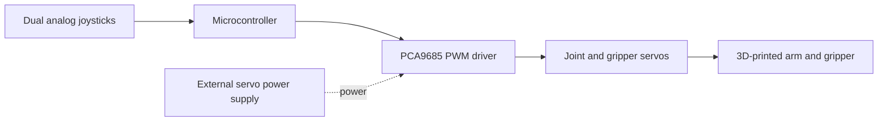

# 3D-Printed Robotic Arm

**Mechanical Design · Additive Manufacturing · Embedded Control · Mechatronics**

A custom robotic arm developed through a complete design–build–test workflow: mechanical modeling in **SolidWorks**, FDM fabrication on a **Bambu Lab P1S**, assembly of servo-driven joints and a geared gripper, and **dual-joystick control** through an Arduino-based system and a **PCA9685 PWM servo driver**.

> **Project status:** Physical prototype assembled; manual control and motion behavior have been tested. The engineering documentation is being expanded. Source CAD, firmware, and measured specifications will be added as those files and data are available.

## At a glance

| Area | Implementation |
| --- | --- |
| Mechanical CAD | SolidWorks; custom base, shoulder, arm/forearm, brackets, gripper, and controller enclosure |
| Manufacturing | FDM 3D printing with Bambu Lab P1S |
| Actuation | Servo-driven joints and gear-driven gripper |
| User interface | Two analog joysticks |
| Electronics | Arduino-based controller and PCA9685 PWM servo driver |
| Firmware | Arduino / C++ |
| Workflow | CAD → print → assemble → integrate → test → revise |

## System architecture

*Conceptual control architecture, not a pin-level wiring diagram. The actual power-distribution and pin connections must be verified against the assembled prototype.*

## What was designed

- **Base and shoulder:** Structural support and rotational / lifting joint interfaces.
- **Arm and forearm:** Custom link geometry connecting the actuated joints.
- **Servo mounts and brackets:** Integration of commercial actuators into printed structures.
- **Gear-driven gripper:** A custom end-effector mechanism for opening and closing.
- **Control enclosure:** A 3D-printed housing for the joystick interface and electronics.

The design emphasizes manufacturable geometry, fastened assembly, servo placement, part fit, and the ability to modify individual printed components.

## Engineering and iteration

This is not just a CAD render or assembled kit. Development included printing individual parts, checking fit, integrating servo motors, and revising both mechanical and control behavior.

Examples documented in the project:

1. **Joystick axis/direction mapping:** Making joystick movement correspond more intuitively to arm movement.
2. **Startup motion:** Investigating rapid movement toward initial servo positions, which could disturb arm stability.
3. **Servo mounting and shaft alignment:** Designing physical mounts while accounting for shaft location and assembly tolerances.
4. **Printability:** Reviewing part orientation, support requirements, holes, and reprints during FDM fabrication.

These are development observations; quantitative improvements are **not** claimed until measured and logged.

## Repository guide

| Folder / file | Contents |
| --- | --- |
| [CAD/](CAD/) | Guidance for publishing native SolidWorks models and printable exports |
| [Firmware/](Firmware/) | Arduino source location and control notes |
| [Electronics/](Electronics/) | Parts list and electronics documentation |
| [Images/](Images/) | Photo / CAD-render organization and upload instructions |
| [Documentation/](Documentation/) | Technical design, manufacturing, testing, and portfolio documentation |
| [Documentation/PROJECT_FACTS.md](Documentation/PROJECT_FACTS.md) | Unverified dimensions, components, and measurements to fill in |
| [.gitignore](.gitignore) | Excludes temporary files while keeping engineering source files |

### Engineering documents

- [Mechanical design](Documentation/MECHANICAL_DESIGN.md)
- [Electronics and control architecture](Documentation/ELECTRONICS_AND_CONTROL.md)
- [Firmware and joystick controls](Documentation/FIRMWARE_AND_CONTROLS.md)
- [Manufacturing and assembly](Documentation/MANUFACTURING_AND_ASSEMBLY.md)
- [Testing and validation plan](Documentation/TESTING_AND_VALIDATION.md)
- [Design challenges and iterations](Documentation/DESIGN_ITERATIONS.md)
- [Résumé / portfolio project summary](Documentation/PORTFOLIO_SUMMARY.md)

## Prototype gallery

Photographs of the assembled prototype and CAD screenshots are being prepared for publication. See the [image naming and upload guide](Images/README.md). The gallery will be embedded here once the photographs are committed.

## Current scope and limitations

The prototype has been assembled and tested with manual joystick input. Public firmware and original CAD files are not yet present in this repository, and servo models, material, power ratings, payload, repeatability, range of motion, and precise dimensions have not been independently verified or measured for this documentation. See the [project fact checklist](Documentation/PROJECT_FACTS.md).

## Next steps

- Publish the original Arduino `.ino` source and verify current joystick mapping against the physical robot.
- Add SolidWorks source, printable STL exports, and assembly images.
- Add verified component specifications, actual wiring/pin map, and printable settings.
- Record motion tests and, if feasible, repeatability / payload observations.
- Embed photographs and a short demonstration video.

---

**Project area:** Mechanical Engineering / Mechatronics · **Repository owner:** [CTK9876](https://github.com/CTK9876)
